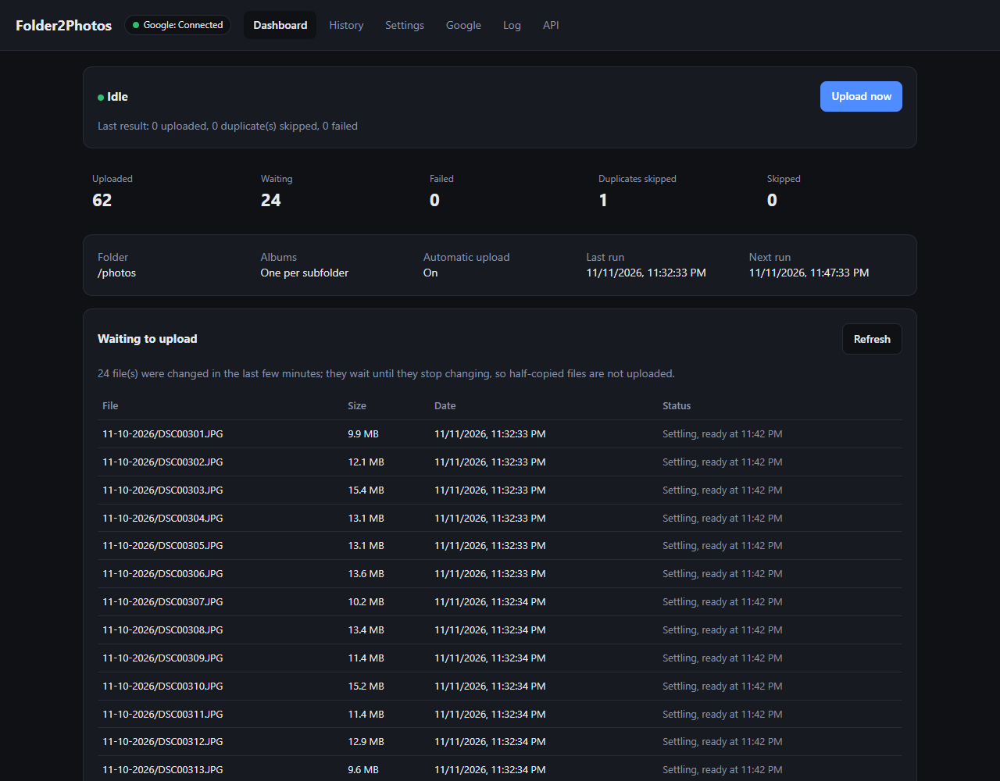

# Folder2Photos

Watches a folder and uploads new photos and videos to Google Photos, all from a web interface.

- **Each file is uploaded once.** Folder2Photos keeps its own history (SQLite in `/config`), so a photo you delete in Google Photos is not uploaded again.
- **No duplicates.** Before uploading, Folder2Photos fingerprints the file (SHA-1). A copy of a photo that was already uploaded, under another name or in another folder, is skipped and listed under Duplicates.
- **Only new files.** What is already in the folder when the app first looks is left alone, unless it is dated on or after the start date (by default the day you install it). Anything you add later is uploaded, whatever date the photo has. You can also mark everything currently in the folder as skipped. New files wait until they have not changed for a few minutes (10 by default), so half-copied files are never uploaded; the Dashboard lists them right away with the time they will be ready.
- **Fast.** Uploads several files at the same time (4 by default, up to 16; set in Settings).
- **Waits for Google.** Nothing is tried, or marked as failed, until a Google login is connected. A file that keeps failing is tried 3 times, then waits for "Retry all failed".
- **Easy on disks.** Each check only re-reads folders that changed, so a large, unchanged library is not read file by file every time.
- **Albums from subfolders.** Photos directly in the folder go to your Google Photos library without an album. Photos in a subfolder go to an album with the subfolder's name, e.g. `Hike 2026`. (Can be turned off.) Date folders written month-day-year, as camera import tools like PlayMemories Home make them (`11-11-2026`), become albums named year-month-day (`2026-11-11`); this can be turned off. Each folder keeps one album: the app remembers which album belongs to which folder, so later files from the same folder always join it, even if Google Photos has several albums with the same name.
- **API and MCP** so scripts and AI assistants can check status, start uploads and change settings.
- **Web interface** with dashboard, waiting list, history (uploaded / failed / skipped, with "upload again"), settings, Google sign-in, and log.

Uploads use [rclone](https://rclone.org/googlephotos/)'s Google Photos backend.



## Run

```bash
docker run -d --name folder2photos -p 8080:8080 \
  -v /mnt/user/appdata/folder2photos:/config \
  -v "/mnt/user/share/Photos & Videos/a6600":/photos:ro \
  -e TZ=America/New_York \
  gjergjk/folder2photos:latest
```

Open `http://SERVER:8080`. On Unraid, install **Folder2Photos** from Community Applications.

| Path / variable | Purpose |
|---|---|
| `/config` | Settings, upload history, `rclone.conf` with the Google login |
| `/photos` | The folder to watch (read only is fine) |
| `TZ` | Time zone for dates and the schedule |
| `WEB_PASSWORD` | Optional password for the web interface. You can also set one in the app (Settings → Web password). Without a password, anyone on your network can use the app. |
| `API_TOKEN` | Optional fixed API token (otherwise one is generated; see the API tab) |

## API and AI assistants

Folder2Photos can be controlled by scripts and AI assistants. The **API** tab in the web interface shows the API token and ready-to-copy examples. Every API and MCP request needs the header `Authorization: Bearer <token>`. You can set your own token with the `API_TOKEN` variable.

**MCP** (for Claude and other MCP clients) is at `/mcp` (streamable HTTP). Tools: `get_status`, `list_pending`, `list_history`, `upload_now`, `stop_upload`, `retry_failed`, `upload_again`, `skip_existing_files`, `get_settings`, `update_settings`, `get_log`, `check_google`.

```bash
claude mcp add --transport http folder2photos http://SERVER:8080/mcp --header "Authorization: Bearer <token>"
```

**REST** endpoints are under `/api/v1`; the full list is at `/api/v1/openapi.json`.

| Method | Path | Does |
|---|---|---|
| GET | `/api/v1/status` | Running or idle, progress, counts, Google connection, next run |
| GET | `/api/v1/pending` | Files waiting to upload |
| GET | `/api/v1/files?status=uploaded` (or failed, skipped, duplicate; `q=` to search) | History |
| POST | `/api/v1/upload` | Start an upload now |
| POST | `/api/v1/stop` | Stop after the current file |
| POST | `/api/v1/files/forget` | Upload these paths again (`{"paths": [...]}`) |
| POST | `/api/v1/files/retry-failed` | Retry failed uploads |
| POST | `/api/v1/skip-existing` | Skip everything currently in the folder |
| GET / PATCH | `/api/v1/settings` | Read or change settings |
| GET | `/api/v1/logs` | Recent activity |
| POST | `/api/v1/google/check` | Test the Google connection |

## Connect Google Photos

Google requires your own OAuth client:

1. In Google Cloud Console, enable the **Photos Library API**.
2. In **Google Auth Platform → Data Access**, add the scopes
   `photoslibrary.appendonly`, `photoslibrary.readonly.appcreateddata`, `photoslibrary.edit.appcreateddata`.
3. In **Audience**, publish the app (otherwise the login expires after 7 days).
4. In **Clients**, create a **Desktop app** client.

Then in Folder2Photos open **Google**, enter the Client ID and secret, click **Sign in with Google**, allow access, and paste the address of the page Google sends you to (it starts with `http://127.0.0.1:53682/` and does not load; that is expected). You can also import an existing `rclone.conf`.
